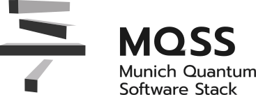

<!----------------------------------------------------------------------------
Copyright 2024 Munich Quantum Software Stack Project

Licensed under the Apache License, Version 2.0 with LLVM Exceptions (the
"License"); you may not use this file except in compliance with the License.
You may obtain a copy of the License at

https://github.com/Munich-Quantum-Software-Stack/DCDB-Daemon/blob/develop/LICENSE

Unless required by applicable law or agreed to in writing, software
distributed under the License is distributed on an "AS IS" BASIS, WITHOUT
WARRANTIES OR CONDITIONS OF ANY KIND, either express or implied. See the
License for the specific language governing permissions and limitations under
the License.

SPDX-License-Identifier: Apache-2.0 WITH LLVM-exception
--------------------------------------------------------------------------->

<p align="center">
  
</p>

# MQSS QDMI-based DCDB Daemon

<p align="center">
  <a href="https://munich-quantum-software-stack.github.io/DCDB-Daemon/">
    
  </a>
  &nbsp;
  <a href="https://github.com/Munich-Quantum-Software-Stack/DCDB-Daemon/actions/workflows/ci.yml">
    
  </a>
</p>

A lightweight C++ daemon that continuously queries telemetry sensor data through the
[QDMI-DCDB](https://github.com/Munich-Quantum-Software-Stack/MQSS-QDMI-Devices-Suite) device
library and writes the results into an [InfluxDB](https://www.influxdata.com/) time-series database
for long-term storage and visualization (Grafana, etc.).

[DCDB](https://gitlab.lrz.de/dcdb/dcdb) (Data Center Data Base) is a modular, continuous, and
holistic monitoring framework targeted at HPC environments.

## FAQ

### What is MQSS?

_MQSS_ stands for _Munich Quantum Software Stack_ and is a project of the _Munich Quantum Valley_
initiative. It is jointly developed by the _Munich Quantum Valley (MQV) gGmbH_, _Leibniz
Supercomputing Centre (LRZ)_, the _Chair for Design Automation (CDA)_, and the _Chair of Computer
Architecture and Parallel Systems (CAPS)_ at TUM. It provides a comprehensive compilation and
runtime infrastructure for on-premise and remote quantum devices, support for modern compilation and
optimization techniques, and enables both current and future high-level abstractions for quantum
programming. This stack is designed to be capable of deployment in a variety of scenarios via
flexible configuration options. This includes stand-alone scenarios for individual systems, cloud
access to a variety of devices, as well as tight integration into HPC environments supporting
quantum acceleration. Concrete instances of the _MQSS_ are deployed at the LRZ and MQV gGmbH,
providing unified access to all of their quantum devices through multiple compatible access paths.
This includes a web portal, command line access via web credentials, as well as the option for
hybrid access with tight integration with HPC systems. It facilitates the connection between
end-users and quantum computing platforms by its integration within HPC infrastructures, such as
those found at the LRZ.

### Where is the code?

The code is publicly available and hosted on GitHub at
[github.com/Munich-Quantum-Software-Stack/DCDB-Daemon](https://github.com/Munich-Quantum-Software-Stack/DCDB-Daemon).

### Under which license is the MQSS QDMI-based DCDB Daemon released?

The **MQSS QDMI-based DCDB Daemon** is released under the Apache License v2.0 with LLVM
Exceptions. See [LICENSE](LICENSE) for more information. Any contribution to the project is assumed
to be under the same license.

## Architecture

```
+-------------------+       +--------------------------------+
| DCDB Sensor Nodes | <---> | QDMI-based DCDB Device Library |
+-------------------+       +--------------------------------+
                                           ^
                                           |
                                           v
 +-----------------+          +-----------------------------+
 |    InfluxDB     |  <--->   | MQSS QDMI-based DCDB Daemon |
 +-----------------+          +-----------------------------+
          ^
          |
          v
 Visualization / Analytics (Grafana, Chronograf, ...)
```

- **DCDB** exposes sensor data (power, temperature, environmental metrics, ...).
- **QDMI-DCDB Device** is the adapter library that queries those sensors.
- **MQSS Daemon** polls the adapter on a rolling time window and pushes results to InfluxDB.

## Requirements

- CMake ≥ 3.19, C++17 compiler (`g++` or `clang++`)
- System libraries: `libuv1-dev`, `libssl-dev`, `libcurl4-openssl-dev`
- Runtime: a running DCDB deployment and an InfluxDB instance

Managed dependencies (cpr, influxdb-cxx, cpp-driver, QDMI-Devices) are handled by the scripts in
`extern/` — no system-wide installation required.

## Repository Structure

```
.
├── src/                  # Daemon source (C++17)
├── docs/                 # Documentation (Doxygen + Markdown)
│   └── logos/            # Project logos
├── extern/               # Managed third-party dependencies
│   ├── clone.sh          # Clone dependencies
│   └── build.sh          # Build and install into extern/installed/
├── examples/             # Usage examples (InfluxDB query, Python telemetry)
├── utils/                # Utility scripts and helper tools
└── test/                 # Standalone tests
```

## Building

**Step 1 — install system prerequisites:**

```bash
sudo apt install -y libuv1-dev libssl-dev libcurl4-openssl-dev
```

**Step 2 — clone and build managed dependencies:**

```bash
bash extern/clone.sh --with-qdmi-devices
bash extern/build.sh --with-qdmi-devices --with-dcdb
```

**Step 3 — export environment variables and build:**

```bash
source build/export_qdmi_dcdb_deps.sh
cmake -S . -B build
cmake --build build -j
```

The daemon binary is placed at `build/mqss_dcdb_daemon`.

See [Getting Started](docs/getting_started.md) for the full step-by-step guide.

## Running

```bash
./mqss_dcdb_daemon --config config.json --dcdb-url localhost:9042
```

See [Usage](docs/usage.md) for all CLI options and the config file format.

## Contact

Please use the publicly accessible GitHub channels —
[issues](https://github.com/Munich-Quantum-Software-Stack/DCDB-Daemon/issues) and
[pull requests](https://github.com/Munich-Quantum-Software-Stack/DCDB-Daemon/pulls) —
to allow for a transparent and open discussion.

## Contributing

See [contributing.md](contributing.md) and [code_of_conduct.md](code_of_conduct.md).

## License

This project is released under the Apache License v2.0 with LLVM Exceptions. See
[LICENSE](LICENSE) for more information. Any contribution to the project is assumed to be under
the same license.